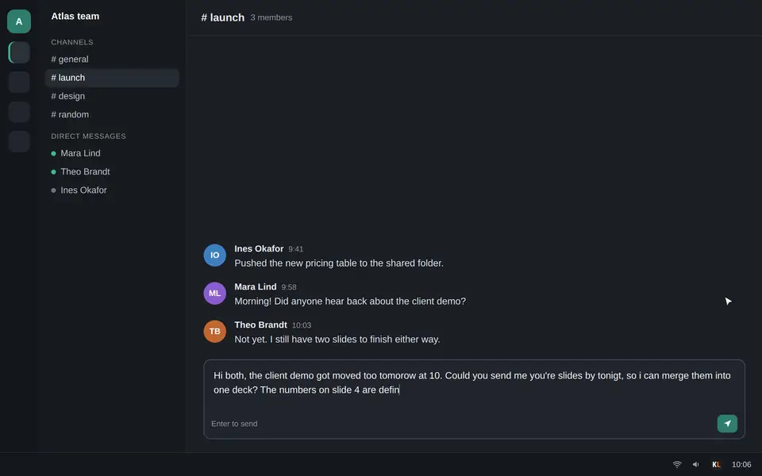

# KeyLint

[](https://github.com/0xMMA/KeyLint/actions/workflows/build-linux.yml)
[](https://github.com/0xMMA/KeyLint/releases/latest)
[](https://github.com/0xMMA/KeyLint/releases)
[](LICENSE)

**Select text. Press Ctrl+G. Fixed.**

KeyLint fixes your writing with AI right where you type: in your mail, your chat, your editor. Free for Windows.

[](https://keylint.io)

<sub>Staged demo (the chat app is a mock-up); the correction is what KeyLint actually returned. More on [keylint.io](https://keylint.io).</sub>

## What it does

- **Silent Fix.** Select text in any app and press <kbd>Ctrl</kbd>+<kbd>G</kbd>. The corrected text replaces your selection. A dot on the tray icon shows KeyLint is working; nothing else pops up.
- **Pyramidize.** Hold <kbd>Ctrl</kbd> and tap <kbd>G</kbd> twice on rough notes. KeyLint opens with them, you pick the form (email, chat message, memo, wiki page or slide outline) and add an instruction if you want one. The result puts the main point first. Copy it as rich text, or send it back to the app you came from, formatted.
- **Fix page.** Paste text into the app to see every change marked before you use it.
- **Multilingual.** English stays English, German stays German: KeyLint corrects without translating.
- **Private.** Your text goes from your PC straight to the provider you picked, with no KeyLint server in between. No telemetry, no cloud sync, no clipboard history, logging off by default. Besides the providers you set up, KeyLint only contacts GitHub, to check for updates when it starts.

## AI providers

Use the AI you already have, in the order the app lists them:

| Provider | How it connects |
|----------|-----------------|
| **Anthropic API** | Your Anthropic API key. |
| **Claude Code (installed CLI)** | No key: KeyLint runs the Claude Code CLI you installed and signed in to, unmodified, so usage counts against your own Claude account. KeyLint never reads, stores or forwards your credentials and never asks you to log in. |
| **OpenRouter** | One OpenRouter key for models from many vendors; the model picker searches the whole catalogue as you type. |
| **OpenAI** | Your OpenAI API key. |
| **AWS Bedrock** | Claude models from your own AWS account, with a Bedrock API key or the AWS sign-in already on your computer (KeyLint stores nothing for it). You choose whether your text stays in your region's geography or may be processed worldwide. |
| **Ollama (local)** | A model on your own machine; your text stays on your PC. |

API keys are kept in your operating system's keyring and only ever sent to the provider they belong to. Environment variables (`ANTHROPIC_API_KEY`, `OPENAI_API_KEY`, `OPENROUTER_API_KEY`, `AWS_BEARER_TOKEN_BEDROCK`) take priority over a saved key.

<sub>Claude Code is Anthropic's product. KeyLint is an independent project and is not affiliated with or endorsed by Anthropic, OpenRouter, OpenAI or Amazon Web Services.</sub>

## Install

1. Download the latest release from [keylint.io](https://keylint.io) or the [Releases page](https://github.com/0xMMA/KeyLint/releases/latest): the installer (`…-windows-amd64-setup.exe`) or the portable `.exe`.
2. Start KeyLint. The setup wizard walks you through choosing a provider; if the Claude Code CLI is installed and signed in, it offers that in one click, with no key to enter.
3. Select some text and press <kbd>Ctrl</kbd>+<kbd>G</kbd>.

KeyLint lives in the system tray: single-click for the menu, double-click to open the window.

## Contributing

Contributions are welcome: open an issue or a pull request.

## License

MIT + Commons Clause, see [LICENSE](LICENSE).

---

<details>
<summary><strong>Development</strong></summary>

### Stack

| Layer | Technology |
|-------|------------|
| Desktop runtime | [Wails v3](https://v3.wails.io/) (Go) |
| Backend | Go 1.27, [Wire](https://github.com/google/wire) for dependency injection |
| AI providers | `internal/llm`: the Anthropic and OpenAI Go SDKs (Anthropic also for Bedrock, OpenAI also for OpenRouter and Ollama), and the spawned Claude Code CLI |
| Frontend | Angular v22, KeyLint's own UI components on Angular CDK (`frontend/src/app/shared/ui`) |
| Styling | Tailwind v4 utilities and `--kl-*` design tokens (dark theme, orange on zinc) |

### Prerequisites

- Go 1.27+ and Node.js 24 LTS
- Wails v3 CLI, the same version as the module in `go.mod` (CI's bindings-drift check uses it): `go install -tags gtk3 github.com/wailsapp/wails/v3/cmd/wails3@v3.0.0-beta.25` (the tag matters on Linux only)
- Install `wails3` and `wire` with Go 1.27 or newer: `go install` builds a tool with the Go version the *tool* declares, so on an older Go they refuse this module ("package requires newer Go version go1.27"). With an older default `go`: `GOTOOLCHAIN=go1.27.1 go install …`
- Linux: `sudo apt install libgtk-3-dev libwebkit2gtk-4.1-dev`, and build and test with `-tags gtk3` (Wails v3 defaults to GTK4; KeyLint stays on GTK3 for now)
- Windows cross-compilation from Linux: `sudo apt install gcc-mingw-w64`

### Build and run

```bash
# Hot-reload dev server (Angular + Go)
wails3 dev

# Frontend only
cd frontend && npm run build

# Production binary (Linux)
go build -tags production,gtk3 -o bin/KeyLint .

# Windows cross-compilation
GOOS=windows GOARCH=amd64 CGO_ENABLED=1 CC=x86_64-w64-mingw32-gcc \
  go build -tags production -ldflags="-w -s -H windowsgui" -o bin/KeyLint.exe .
```

After changing a Go service: `wire gen ./internal/app/`, then `wails3 generate bindings`, then build.

### Command line

The same binary runs headless, with the same prompts as the app:

```bash
./bin/KeyLint -fix "text to fix"
./bin/KeyLint -fix -f input.txt
./bin/KeyLint -pyramidize -type email -f notes.md          # email | chat | memo | wiki | powerpoint
./bin/KeyLint -pyramidize --json -f notes.md
./bin/KeyLint -pyramidize --provider claude --model claude-sonnet-4-6 -f notes.md
```

### Tests

```bash
cd frontend && npm test               # Vitest
go test -tags gtk3 ./internal/...     # Go
cd frontend && npx playwright test    # E2E (starts ng serve on :4200 itself)
```

### Evaluation

Fix and Pyramidize each have an eval suite: deterministic checks plus two LLM judges, reported separately. They make real model calls, so they are behind the `eval` build tag and never run with the normal tests. By default the pipeline and the judges go through the installed Claude Code CLI on your own subscription, with no API key.

```bash
./scripts/eval.sh                          # one run of the Pyramidize suite
./scripts/eval.sh --suite fix --runs 3     # the Fix suite, three runs (a baseline)
./scripts/eval.sh --runs 3 --compare test-data/eval-baselines/<ts>/baseline.json
./scripts/eval-human.sh                    # side-by-side human review
```

Results land in `test-data/eval-runs/<timestamp>/`. Against the API instead: `--provider claude` with `ANTHROPIC_API_KEY` in `.env` (copy `.env.example`). The details, and why one run is a sample rather than a measurement, are in [`CLAUDE.md`](CLAUDE.md#what-the-map).

### Project structure

```
KeyLint/
├── main.go                  # Entry point: CLI dispatch, Wails app setup
├── internal/
│   ├── app/                 # Wire DI (wire.go + generated wire_gen.go)
│   ├── cli/                 # Headless -fix / -pyramidize
│   ├── llm/                 # Provider layer: the only place that calls an AI provider
│   └── features/            # Vertical slices: settings, shortcut, clipboard, tray, enhance,
│                            # silentfix, notify, welcome, logger, updater, pyramidize
├── frontend/
│   ├── src/app/
│   │   ├── core/            # WailsService (the only bridge to Go), providers, guards
│   │   ├── features/        # fix, text-enhancement (Pyramidize), settings, welcome-wizard, dev-tools
│   │   ├── layout/          # Sidebar shell
│   │   └── shared/ui/       # KeyLint's UI components
│   └── bindings/            # Generated by wails3 generate bindings
├── website/                 # keylint.io (GitHub Pages)
├── scripts/                 # Eval runners; website/ captures the site's screenshots and clips
└── docs/                    # Roadmap, design decisions, quality status
```

### CI/CD

- **`build-linux.yml`**: every pull request and push to `main`: tests, E2E, Linux and Windows builds, and a dev build published as a prerelease (`v0.0.0-pr.N`, `v0.0.0-main`).
- **`release.yml`**: a `v*` tag builds the release binaries and `latest.json` for the in-app updater, and opens a draft release.
- **`pages.yml`**: deploys `website/` to keylint.io when it changes on `main`.

Priorities and the release train live in [`docs/roadmap.md`](docs/roadmap.md).

</details>
